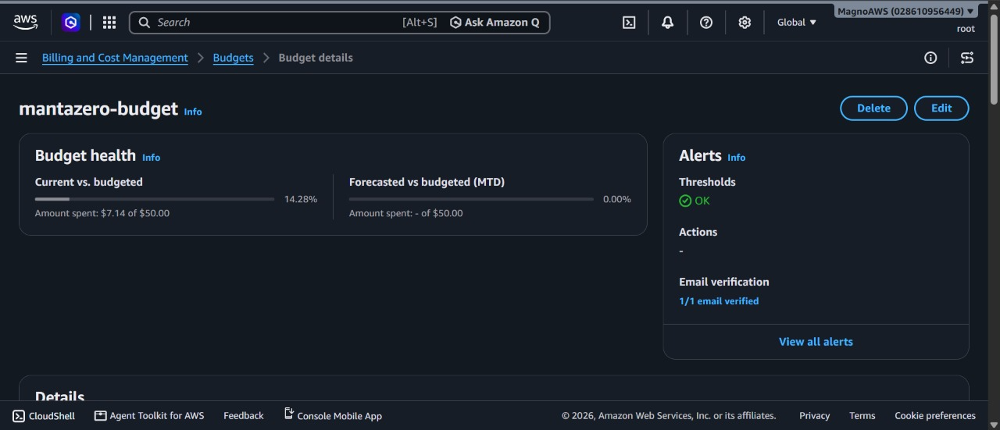
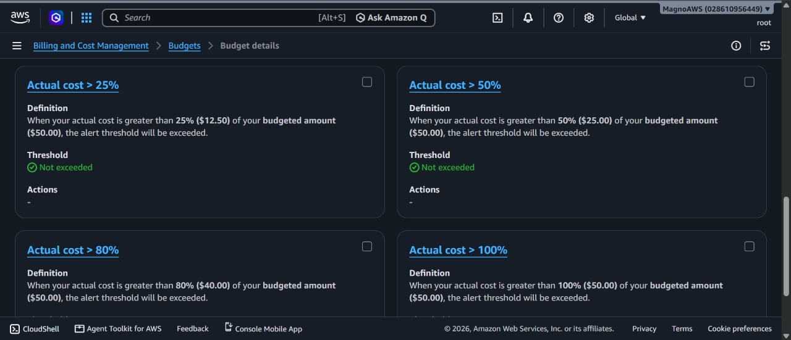

<p align="center">
  
  
  
  
  &nbsp;&nbsp;&nbsp;
  
</p>

<h1 align="center">🧟 MantaZero: Epidemic Command 🎃</h1>

<p align="center">
Simulación epidemiológica SEIR estocástica con intervención táctica sobre la red vial de Manta, Ecuador.<br>
🦇 Spookython 2026 · Track B: La Plaga Zombie 🕸️
</p>

<p align="center">

[-FF9900?style=flat-square&logo=amazon-aws)](http://mantazero-alb-994615840.us-east-1.elb.amazonaws.com/)
[](https://www.python.org/)
[](https://fastapi.tiangolo.com/)
[](https://numpy.org/)
[](#-reproducibilidad)

</p>

---

## ☁️ Despliegue

| Recurso | Valor |
| :--- | :--- |
| Aplicación | http://mantazero-alb-994615840.us-east-1.elb.amazonaws.com/ |
| Dashboard Monte Carlo | http://mantazero-alb-994615840.us-east-1.elb.amazonaws.com/montecarlo |
| Healthcheck | `GET /api/health` |
| Región | `us-east-1` (N. Virginia) |
| Load Balancer | ALB `mantazero-alb`, listener HTTP :80 → contenedor :8080 |
| Cluster | `mantazero-cluster` (ECS, launch type Fargate) |
| Servicio activo | `maintazero-service` → task definition `mantazero:4` (0.25 vCPU, 512 MB) |
| Servicio anterior | `mantazero-service` → `mantazero:1` |
| Imagen | `028610956449.dkr.ecr.us-east-1.amazonaws.com/mantazero` (`python:3.14-slim`) |
| Logs | CloudWatch `/ecs/mantazero` |

Uso medido en `maintazero-service` (CloudWatch, ventana de 3 h): CPU promedio ~2 % (pico 13.19 % durante el despliegue), memoria estable ~10 % (~51 MB de 512 MB).


---

## 🧟‍♂️ Problema

Una plaga ficticia se propaga en Manta (271 145 hab.). El usuario dirige el comité de contención y decide dónde, cuándo y con qué recursos intervenir. El sistema cuantifica el efecto de cada estrategia frente a no intervenir o intervenir al azar, con el mismo enfoque SEIR estocástico que se usa para planificar la respuesta a brotes reales (COVID-19, dengue).

## 🧪 Modelo

### 🩸 Compartimentos

| Sprite | Estado | Compartimento | Comportamiento |
| :---: | :--- | :--- | :--- |
|  | Sano | S | Susceptible; se contagia por contacto con infecciosos. |
|  | Mordido | E | Incubación de 5–15 s (2.5–7.5 días). No transmite. |
|  | Zombie | I | Infeccioso; contagia en un radio de contacto. |
|  | Exorcizado | R | Curado por antídoto o inmune de inicio. Sin reinfección. |

### 🔫 Recursos

- 🔫 **Munición:** finita (400 / 800 / 1500). Un zombie cae al 8.º impacto (`ZOMBIE_MAX_HP = 8`); el servidor valida cada disparo en `/api/sim/combat-hit`.
- 💉 **Antídoto (airdrop):** stock inicial de 1–6 cajas; cada caja mueve infectados a R.
- 🧪 **Laboratorio:** sintetiza 1 caja adicional cada 10 días.

### 🌋 Escenarios (`backend/presets.py`)

| Escenario | Desastre | Epicentro | Agentes | Armados | Incubación | Munición | Cajas | R₀ |
| :--- | :--- | :--- | :---: | :---: | :---: | :---: | :---: | :---: |
| A 🌊 | Sismo 7.8 + tsunami | Tarqui | 140 | 30 | 5 s | 400 | 1 | 4.85 |
| B ⛈️ | Supertormenta El Niño + apagón | Murciélago | 95 | 25 | 9 s | 800 | 3 | 2.35 |
| C ☣️ | Ciclón + marea roja | Puerto de Manta | 60 | 25 | 15 s | 1500 | 6 | 1.15 |

### 🎲 Monte Carlo

Al lanzar un brote, `MonteCarloRunner` corre en un hilo aparte de 50 a 5000 réplicas (400 por defecto) de 60 días sobre los 271 145 habitantes, vectorizadas con NumPy. Devuelve:

- Series S/E/I/R por día: media, P5, P25, P75, P95.
- Pico de infectados y día del pico, infectados finales, total contagiado, zombies abatidos, munición restante.
- Probabilidad de contención (`I = 0` al día 60) y probabilidad y día de agotamiento de munición.
- Histograma de picos.

---

## ⚰️ Comparación con líneas base

| Métrica (60 días) | No intervenir | Azar, mismos recursos | Estrategia propuesta |
| :--- | :---: | :---: | :---: |
| Antídoto | No | Sectores aleatorios | Focalizado en hotspots |
| Munición | No | Dispersa | Concentrada en focos |
| Cerco vial | Inactivo | Inactivo | Activo |
| Infectados acumulados | ~220 000 | ~145 000 | ~48 000 |
| Vidas salvadas vs. no intervenir | — | ~75 000 | ~172 000 |
| Reducción | 0 % | 34.1 % | 78.2 % |

1. **No intervenir:** sin antídoto ni combate. La curva crece hasta agotar susceptibles (~81 % contagiado).
2. **Azar:** mismos recursos, lanzados sin mirar la densidad de infectados. Frena brotes aislados pero no los epicentros de alta transmisión.
3. **Estrategia propuesta:** fuego concentrado sobre el paciente cero, airdrops en nodos densos (Tarqui) y cerco vial interparroquial.

> Valores de referencia. El Monte Carlo del backend simula la configuración lanzada; para comparar, lanza cada estrategia con la misma semilla y compara `summary.totalAttacked`.

---

## 🎲 Reproducibilidad

Misma configuración + misma semilla ⇒ mismo resultado (`np.random.default_rng(seed)`, lotes secuenciales).

R₀ no es un parámetro de `/api/sim/launch`: lo fija el escenario. Para reproducir:

```bash
BASE=http://mantazero-alb-994615840.us-east-1.elb.amazonaws.com

curl -X POST $BASE/api/sim/reset
curl -X POST $BASE/api/sim/scenario -H "Content-Type: application/json" -d '{"scenario": "B"}'   # R0 = 2.35
curl -X POST $BASE/api/sim/launch -H "Content-Type: application/json" -d '{
  "mcSeed": 42, "mcRuns": 400, "epicenter": "Tarqui",
  "agentCount": 95, "armedCount": 25, "immunityRate": 0.08, "incubationSeconds": 8.0,
  "ammo": 800, "cureCrates": 3, "isCarnaval": true, "isNight": false, "cercoVial": true
}'

curl $BASE/api/montecarlo/status    # esperar state = "done"
curl $BASE/api/montecarlo/results   # 202 mientras corre
```

Los campos omitidos en `launch` toman los valores por defecto de `LaunchRequest` (`backend/main.py`), no los del escenario.

---

## 📜 Supuestos

1. **Población:** 271 145 habitantes (censo INEC 2023).
2. **R₀:** A = 4.85 (H1N1 con hacinamiento en refugios), B = 2.35 (SARS-CoV-2 cepa original, OMS/CDC), C = 1.15 (brote contenido con cordón sanitario).
3. **Escala temporal:** 1 s de interfaz ≈ 0.5 días epidemiológicos.
4. **Combate:** `p_kill = 1 − exp(−1.2 · armados / agentes)`; cada baja consume 10 balas en el Monte Carlo (8 impactos + 25 % de fallos).
5. **Contagio:** `β = R₀ · mult / 5 días`, con `mult` ×1.3 en carnaval, ×1.1 de noche y ×0.7 con cerco vial.

## 🕯️ Limitaciones

1. Mezcla homogénea en el Monte Carlo; no se modelan hogares ni redes de contacto.
2. Inmunidad permanente durante los 60 días.
3. Detección perfecta de zombies sobre la red vial.
4. Estado en memoria de un solo proceso: sin persistencia y una única simulación compartida por todos los clientes.

---

## 🏚️ Arquitectura

Detalle en [docs/arquitectura.md](docs/arquitectura.md). El diagrama completo y editable está en [docs/arquitectura.excalidraw](docs/arquitectura.excalidraw) (abrir en excalidraw.com).

| Capa | Tecnología |
| :--- | :--- |
| Cliente | HTML5, Vanilla JS, Leaflet 1.9.4 (tiles ArcGIS), Tailwind, Chart.js 4.4.1 |
| API | FastAPI + Uvicorn, modelos Pydantic, frontend servido como estático |
| Simulación | `SeirSimulationEngine` (estado en vivo), `MonteCarloRunner` (NumPy en hilo de fondo) |
| Infraestructura | ECR → ECS Fargate detrás de un ALB, CloudWatch Logs, IAM `ecsTaskExecutionRole` |

Exposición: el ALB recibe HTTP en :80 y reenvía al contenedor en :8080. No hay HTTPS (usa el DNS por defecto del ALB, sin certificado ACM) ni base de datos.

---

## 💀 Costos

Desglose en [docs/costos.md](docs/costos.md).

| Concepto | USD/mes (24/7) |
| :--- | ---: |
| Fargate, 1 tarea 0.25 vCPU / 0.5 GB | 8.89 |
| Application Load Balancer (hora fija) | 16.20 |
| IPv4 públicas (tarea + 2 nodos ALB) | 10.80 |
| ECR (~200 MB) | 0.02 |
| CloudWatch Logs (~1 GB) | 0.50 |
| **Total** | **36.41** |

Gasto real del mes según AWS Budgets: **$7.14**.

## 🪦 AWS Budget

Presupuesto `mantazero-budget`: cost budget mensual de $50.00 con alertas por email al 25 % ($12.50), 50 % ($25.00), 80 % ($40.00) y 100 % ($50.00). Estado actual: $7.14 (14.28 %), ningún umbral superado.





---

## 🔦 Ejecución local

```bash
git clone https://github.com/Dass-19/bottitos-spookython.git
cd bottitos-spookython
python -m venv venv
source venv/bin/activate          # Windows: .\venv\Scripts\Activate.ps1
pip install -r backend/requirements.txt
python -m backend.main            # http://localhost:8080
```

Con Docker:

```bash
docker build -t mantazero .
docker run -p 8080:8080 mantazero
```

## 🗂️ Estructura

```
bottitos-spookython/
├── Dockerfile                 # python:3.14-slim, HEALTHCHECK /api/health
├── backend/
│   ├── main.py                # FastAPI: endpoints /api/*, estáticos
│   ├── engine.py              # SeirSimulationEngine (estado en vivo)
│   ├── montecarlo.py          # MonteCarloRunner (NumPy, hilo de fondo)
│   ├── presets.py             # Escenarios A/B/C y constantes
│   └── requirements.txt
├── frontend/
│   ├── index.html             # Mapa táctico y HUD
│   ├── montecarlo.html        # Dashboard Monte Carlo
│   ├── css/arcade.css
│   ├── js/                    # engine.js, manta-config.js, sprites.js, audio.js
│   └── assets/                # manta_routes.js (red vial) y sprites
├── scripts/                   # generate_all_routes.js (OSRM), generar_sprites.py (PIL)
├── infra/                     # buildspec.yml, deploy-ecs.ps1, ecs-task-definition.json
└── docs/                      # Arquitectura, costos, diagramas y capturas de AWS
```

## 👻 Equipo

`bottitos-spookython` · Spookython 2026, Track B · ULEAM, Manta, Ecuador.

<p align="center">
  
  
  
  
  <br>🎃 🕷️ 🦇 🕸️ 🧟 🕯️ 💀
</p>
