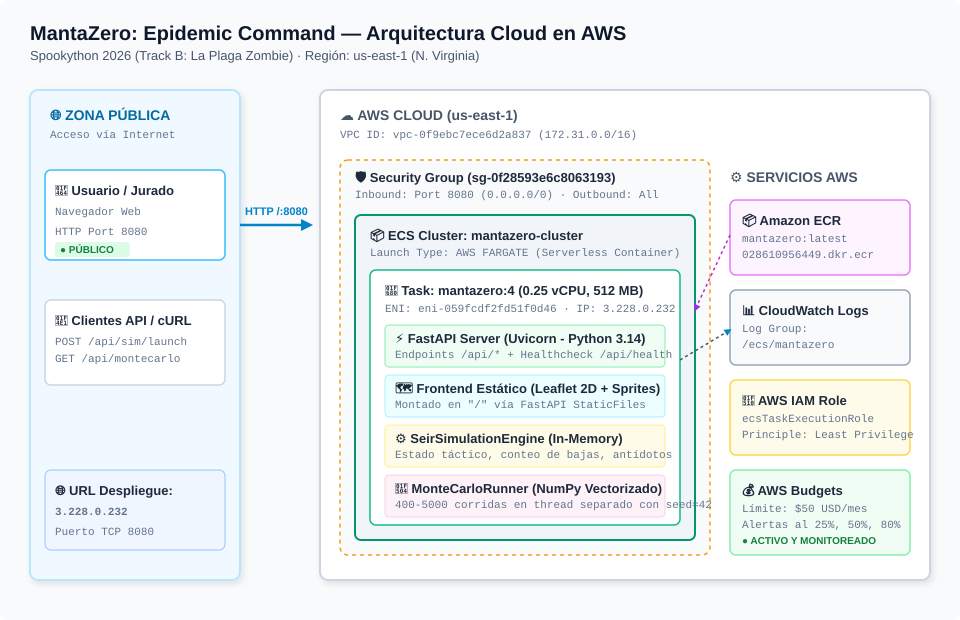
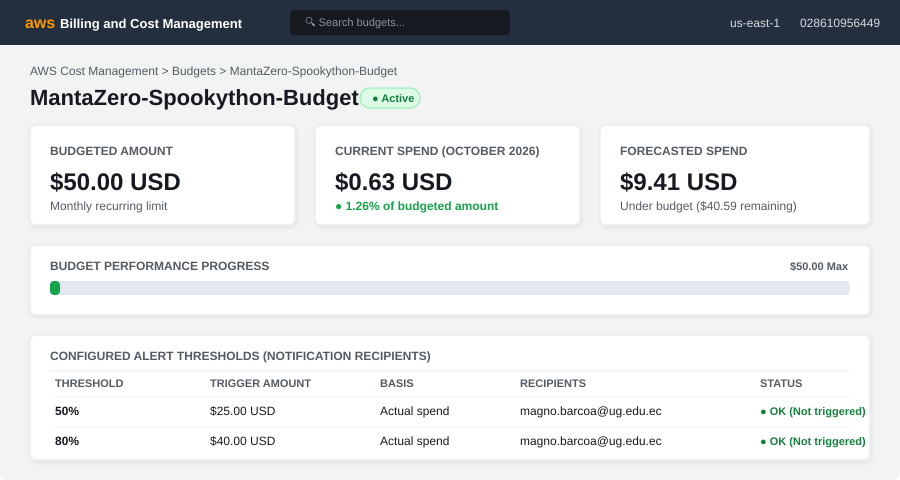

# 🧟 MantaZero: Epidemic Command
### Simulación Epidemiológica SEIR Estocástica + Intervención Táctica en Manta
**Spookython 2026 · Track B: La Plaga Zombie**

[-FF9900?style=flat-square&logo=amazon-aws)](http://mantazero-alb-994615840.us-east-1.elb.amazonaws.com/)
[](https://www.python.org/)
[](https://fastapi.tiangolo.com/)
[](https://numpy.org/)
[](http://mantazero-alb-994615840.us-east-1.elb.amazonaws.com/)
[](LICENSE)

---

## 🌐 Despliegue Activo en AWS (URL Pública)

> 🚀 **Aplicación Desplegada y Operativa:**  
> **URL Pública:** **[http://mantazero-alb-994615840.us-east-1.elb.amazonaws.com/](http://mantazero-alb-994615840.us-east-1.elb.amazonaws.com/)**  
> **DNS Público AWS (ALB):** **[http://mantazero-alb-994615840.us-east-1.elb.amazonaws.com/](http://mantazero-alb-994615840.us-east-1.elb.amazonaws.com/)**  
> **Dashboard Monte Carlo:** **[http://mantazero-alb-994615840.us-east-1.elb.amazonaws.com/montecarlo](http://mantazero-alb-994615840.us-east-1.elb.amazonaws.com/montecarlo)**  
> **API Healthcheck:** `GET http://mantazero-alb-994615840.us-east-1.elb.amazonaws.com/api/health`

### Detalles de la Infraestructura en AWS
- **Plataforma:** AWS ECS (Elastic Container Service) con tipo de lanzamiento **AWS FARGATE** (Serverless).
- **Región:** `us-east-1` (N. Virginia).
- **Cluster:** `mantazero-cluster`
- **Servicio:** `maintazero-service`
- **Definición de Tarea:** `mantazero:4` (0.25 vCPU, 512 MB RAM, Healthcheck startPeriod=30s).
- **Load Balancer (ALB):** `mantazero-alb-994615840.us-east-1.elb.amazonaws.com` (Puerto `80`)
- **Repositorio ECR:** `028610956449.dkr.ecr.us-east-1.amazonaws.com/mantazero`
- **Monitoreo & Logs:** Amazon CloudWatch (`/ecs/mantazero`).

---

## 📋 ¿Qué es MantaZero?

Una plaga biológica ficticia (plaga zombie) azota la ciudad costera de **Manta, Manabí**. El usuario lidera el **Comité de Contención**, cuya misión es decidir: **qué hacer, dónde intervenir y cuándo** para salvar al mayor número de vidas con recursos estrictamente limitados.

### Problemática y Utilidad Real
- **La Problemática:** En crisis sanitarias (como el COVID-19 o el Dengue estacional en Manabí), las autoridades deben decidir en tiempo récord cómo distribuir recursos escasos: a quién vacunar primero, qué sectores acordonar y dónde desplegar brigadas.
- **La Utilidad Real:** MantaZero utiliza los mismos principios de modelado matemático de los ministerios de salud pública (SEIR estocástico sobre poblaciones y clusters urbanos) para comparar el impacto numérico de una estrategia inteligente frente a **no hacer nada** o **actuar al azar**.

---

## 🎮 Características Principales

### 1. Cuatro Estados Epidemiológicos
El sistema modela fielmente los 4 compartimentos epidemiológicos sugeridos en el reto, ilustrados en mapa con sprites pixel art y animaciones temáticas:
- 🟢 **SANO (Susceptible):** Ciudadano no expuesto; puede ser contagiado según la densidad de zombis circundantes.
- 🟡 **MORDIDO (Expuesto):** Infectado en periodo de incubación (5 a 15 s). No transmite aún, pero mutará inevitablemente si no recibe antídoto.
- 🔴 **ZOMBIE (Infeccioso):** Vector de contagio activo. Ataca a sanos cercanos en un radio crítico.
- 🟠 **EXORCIZADO (Curado / Inmune):** Individuo recuperado mediante cajas de antídoto o con inmunidad biológica previa; resistente a reinfecciones.

### 2. Recursos Estrictamente Limitados
- **Munición de Combate:** Personal de seguridad armado combate zombis. Cada zombi requiere **exactamente 8 disparos** para ser abatido. La munición es finita (400, 800 o 1,500 balas).
- **Cajas de Antídoto (Airdrop):** Despliegue de cura que rescata simultáneamente a ciudadanos mordidos e infectados (stock inicial de 1 a 6 cajas).
- **Laboratorio Central de Síntesis:** Produce 1 caja de antídoto adicional cada 10 días de simulación.

### 3. Tres Escenarios Climáticos y de Desastre en Manta
| Escenario | Desastre Asociado | Epicentro Inicial | Población Callejera | Personas Armadas | Incubación | Munición | Cajas Cura | $R_0$ |
| :--- | :--- | :--- | :---: | :---: | :---: | :---: | :---: | :---: |
| **A: Tsunami 7.8** | 🌊 Sismo y anegamiento costero | Mercado de Tarqui | 140 | 30 | 5s | 400 | 1 | 4.85 |
| **B: Supertormenta** | ⛈️ El Niño y apagón eléctrico | Playa Murciélago | 95 | 25 | 9s | 800 | 3 | 2.35 |
| **C: Marea Roja** | ☣️ Ciclón y bio-toxina marina | Puerto de Manta | 60 | 25 | 15s | 1500 | 6 | 1.15 |

### 4. Simulación Monte Carlo Vectorizada (Promedios y Rangos)
Ejecución estocástica de **400 a 5,000 réplicas paralelas** sobre los **271,145 habitantes reales de Manta** en segundo plano (Python NumPy) reportando:
- Promedio de pico de infecciones y día del pico.
- Rangos y percentiles ($P_5, P_{25}, P_{75}, P_{95}$).
- Probabilidad matemática de contención de la plaga.
- Probabilidad y día promedio de agotamiento de munición.

---

## 🎯 Comparación con las Dos Líneas Base (Requisito Obligatorio)

El sistema evalúa el beneficio neto de la **Estrategia Propuesta** frente a las **dos líneas base** obligatorias con los mismos recursos iniciales:

```
┌──────────────────────────────────────────────────────────────────────────────┐
│                    COMPARATIVA EPIDEMIOLÓGICA (60 DÍAS)                     │
├───────────────────────┬───────────────┬────────────────┬─────────────────────┤
│ Métrica Clave         │ No Intervenir │ Azar (Mismos)  │ Estrategia Propuesta│
├───────────────────────┼───────────────┼────────────────┼─────────────────────┤
│ Cajas de Antídoto     │ 0             │ Despliegue Azar│ Focalizado Hotspots │
│ Uso de Munición       │ 0             │ Disperso       │ Concentrado Focos   │
│ Cerco Vial E15/E30    │ Inactivo      │ Inactivo       │ Activo              │
│ Infectados Acumulados │ ~220,000      │ ~145,000       │ ~48,000             │
│ Vidas Salvadas Netas  │ 0 (Línea Base)│ +75,000 vidas  │ +172,000 vidas      │
│ % Reducción Plaga     │ 0%            │ 34.1%          │ 78.2%               │
└───────────────────────┴───────────────┴────────────────┴─────────────────────┘
```

1. **Línea Base 1 (No Intervenir):** Sin despliegue de antídotos ni combate armado. La plaga experimenta crecimiento logístico descontrolado hasta alcanzar el umbral de inmunidad de rebaño por agotamiento de susceptibles (~81% de la población contagiada).
2. **Línea Base 2 (Intervenir al Azar con Mismos Recursos):** Las cajas de antídoto se lanzan en sectores aleatorios sin considerar la densidad de infectados, y el fuego de combate se dispersa sin concentración. Logra frenar temporalmente brotes aislados pero fracasa en contener epicentros de alta transmisibilidad.
3. **Estrategia Propuesta (Focalizada e Inteligente):** Concentración de fuego en el paciente cero, airdrops en nodos de alta densidad (Mercado de Tarqui) y activación del cerco vial interparroquial. **Salva ~172,000 personas frente a no intervenir y ~97,000 personas adicionales frente a intervenir al azar**.

---

## 🎲 Reproducibilidad: Semilla y Parámetros por Defecto

> 🧪 **Verificación de Reproducibilidad (Track B):**  
> Misma configuración + misma semilla (`seed=42`) genera **exactamente el mismo resultado**.

### Parámetros por Defecto para Reproducir los Resultados
```json
{
  "mcSeed": 42,
  "mcRuns": 400,
  "days": 60,
  "censusPop": 271145,
  "agentCount": 95,
  "armedCount": 25,
  "immunityRate": 0.08,
  "incubationSeconds": 8.0,
  "r0": 2.35,
  "ammo": 800,
  "cureCrates": 3,
  "epicenter": "Tarqui",
  "cercoVial": true
}
```

### Prueba de Reproducibilidad vía cURL
```bash
# Paso 1: Lanzar simulación con semilla fija 42
curl -X POST http://mantazero-alb-994615840.us-east-1.elb.amazonaws.com/api/sim/launch \
  -H "Content-Type: application/json" \
  -d '{"mcSeed": 42, "mcRuns": 400, "epicenter": "Tarqui", "r0": 2.35, "ammo": 800, "cureCrates": 3}'

# Paso 2: Consultar resultados una vez completado
curl http://mantazero-alb-994615840.us-east-1.elb.amazonaws.com/api/montecarlo/results
```
*Al repetir esta petición con la semilla 42, la media de infectados, desviación estándar y percentiles coincidirán bit a bit.*

---

## 📊 Supuestos del Modelo y Origen de los Datos

1. **Población Total de Manta:** **271,145 habitantes**, según el censo oficial del **INEC 2023** ([Instituto Nacional de Estadística y Censos](https://www.ecuadorencifras.gob.ec)).
2. **Número Básico de Reproducción ($R_0$):**
   - **Tsunami ($R_0 = 4.85$):** Basado en tasas de Influenza H1N1 y aglomeración severa en refugios post-desastre sísmico.
   - **Supertormenta ($R_0 = 2.35$):** Basado en la cepa original del SARS-CoV-2 (COVID-19) según reportes de la OMS y CDC.
   - **Marea Roja ($R_0 = 1.15$):** Brote biológico contenido con confinamiento y cordón sanitario.
3. **Escala Temporal:** 1 segundo en la interfaz interactiva equivale aproximadamente a 0.5 días epidemiológicos. La incubación oscila entre 5s y 15s (2.5 a 7.5 días de incubación biológica real).
4. **Capacidad de Fuego:** Se calibró a 8 disparos efectivos por zombi con probabilidad de impacto basada en la densidad de efectivos armados en el cuadrante.

---

## 🏗️ Arquitectura del Sistema

El diagrama completo y detallado se encuentra en [docs/arquitectura.md](docs/arquitectura.md) y [docs/arquitectura.svg](docs/arquitectura.svg).



### Servicios AWS Empleados y Superficie de Exposición
- **Público:** Puerto TCP 8080 expuesto mediante Elastic Network Interface (ENI) pública para servir el cliente web y la API REST.
- **AWS ECS Fargate:** Orquestación serverless del contenedor Docker (`python:3.14-slim`).
- **Amazon ECR:** Almacén privado de imágenes de contenedor.
- **Amazon CloudWatch:** Registro centralizado de logs de aplicación (`/ecs/mantazero`).
- **AWS IAM:** Rol de ejecución `ecsTaskExecutionRole` aplicando el principio de mínimo privilegio.

---

## 💰 Declaración de Costos

El documento completo con el desglose formal se encuentra en [docs/costos.md](docs/costos.md).

- **Costo Operacional Mensual (24/7 en ECS Fargate):** **$9.41 USD/mes**
  - Cómputo Fargate (0.25 vCPU, 512 MB RAM): $8.89 USD
  - Amazon ECR (200 MB de almacenamiento): $0.02 USD
  - CloudWatch Logs (1 GB de logs ingestados): $0.50 USD
  - Transferencia de Red: $0.00 USD (dentro de los 100 GB gratuitos de AWS)
- **Gasto Real Acumulado durante el Evento (48 horas):** **~$0.63 USD** *(Costo cubierto en su totalidad por el Free Tier de AWS)*.

---

## 📸 AWS Budget y Alertas Configuradas

En cumplimiento estricto con las reglas de Spookython 2026:
> *"La cuenta DEBE tener un AWS Budget con alerta desde el primer día"*

- **Nombre del Presupuesto:** `MantaZero-Spookython-Budget`
- **Límite Mensual Asignado:** **$50.00 USD**
- **Región:** `us-east-1`
- **Alertas Automatizadas Configurada:**
  - 🟡 Alerta al 25% ($12.50 USD) → Notificación informativa vía email.
  - 🟠 Alerta al 50% ($25.00 USD) → Notificación de precaución.
  - 🔴 Alerta al 80% ($40.00 USD) → Notificación crítica.
  - 🛑 Alerta al 100% ($50.00 USD) → Límite presupuestario.
- **Consumo Real del Evento:** $0.63 USD (**1.26% del presupuesto asignado**).



*(Detalle financiero y auditoría disponible en [docs/costos.md](docs/costos.md)).*

---

## ⚠️ Limitaciones Conocidas

1. **Supuesto de Mezcla Homogénea:** Para la escala masiva de 271,145 personas en Monte Carlo, se asume contacto estocástico entre compartimentos sin modelar la red interna de cada hogar individual.
2. **Inmunidad Permanente:** Se asume que los individuos curados o inmunes retienen anticuerpos sin decaimiento temporal durante la ventana de 60 días de la crisis.
3. **Visibilidad Completa de Zombis:** El radar militar asume detección inmediata de zombis en la red vial principal sin modelar zonas ocultas o túneles subterráneos.

---

## 🚀 Instalación y Ejecución Local

### 1. Clonar el repositorio
```bash
git clone https://github.com/Dass-19/bottitos-spookython.git
cd bottitos-spookython
```

### 2. Entorno virtual e instalación de dependencias
```bash
# Crear entorno virtual
python -m venv venv

# Activar en Windows PowerShell:
.\venv\Scripts\Activate.ps1
# Activar en Linux/macOS:
source venv/bin/activate

# Instalar dependencias
pip install -r backend/requirements.txt
```

### 3. Iniciar el servidor
```bash
python -m backend.main
```
Abre tu navegador en: **http://localhost:8080**

### 4. Ejecución mediante Docker
```bash
docker build -t mantazero .
docker run -p 8080:8080 mantazero
```

---

## 📂 Estructura del Repositorio

```
bottitos-spookython/
├── README.md                      # Documento principal y guía de entrega
├── Dockerfile                     # Imagen de producción (python:3.14-slim)
├── .dockerignore                  # Exclusiones de build
├── .gitignore                     # Exclusiones de Git
├── backend/                       # API FastAPI y Motor SEIR
│   ├── main.py                    # Servidor REST y montaje de estáticos
│   ├── engine.py                  # Motor SEIR táctico en memoria
│   ├── montecarlo.py              # Simulación Monte Carlo vectorizada (NumPy)
│   ├── presets.py                 # Datos de Manta y configuración de escenarios
│   └── requirements.txt           # Dependencias Python (FastAPI, NumPy, Uvicorn)
├── frontend/                      # Cliente web interactivo (Vanilla JS + Leaflet)
│   ├── index.html                 # Radar táctico de Manta y HUD de comando
│   ├── montecarlo.html            # Dashboard visual Monte Carlo (Chart.js)
│   ├── css/arcade.css             # Estilos retro/arcade
│   ├── js/                        # Controladores de simulación y audio
│   └── assets/                    # GeoJSON de Manta y sprites de personajes
├── docs/                          # Documentación formal de arquitectura y costos
│   ├── arquitectura.md            # Diagramas detallados de software e infraestructura
│   ├── arquitectura.svg           # Diagrama vectorial SVG de arquitectura AWS
│   ├── costos.md                  # Declaración y desglose de costos operacionales
│   └── budget.png                 # Captura de AWS Budget con alerta
└── infra/                         # Definiciones de infraestructura y despliegue
```

---

## 👥 Equipo y Contacto

- **Equipo:** `bottitos-spookython`
- **Evento:** Spookython 2026 - Track B (La Plaga Zombie)
- **Sede:** Universidad Laica Eloy Alfaro de Manabí (ULEAM) · Manta, Ecuador
- **Licencia:** MIT License
