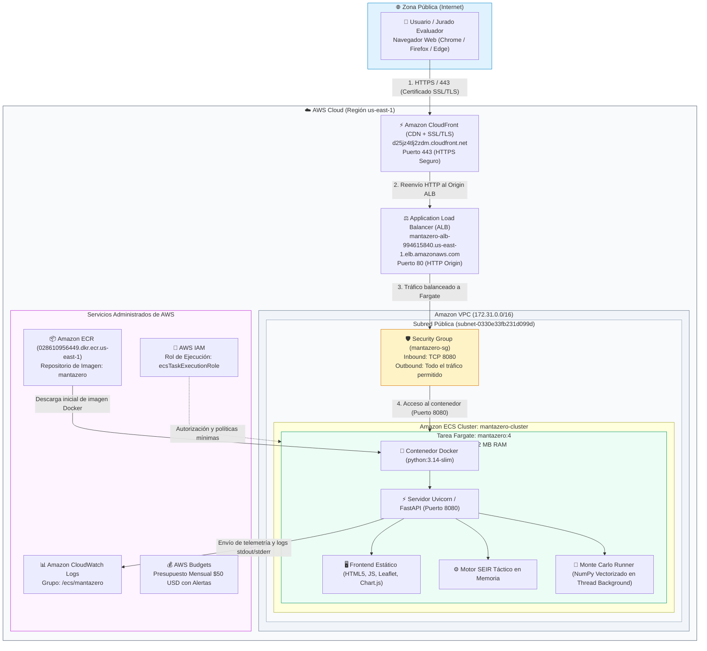
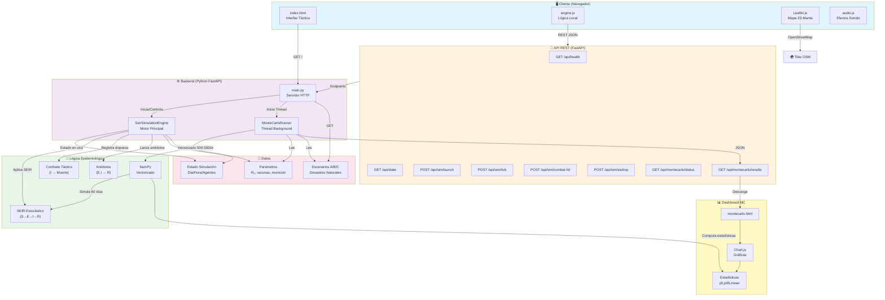
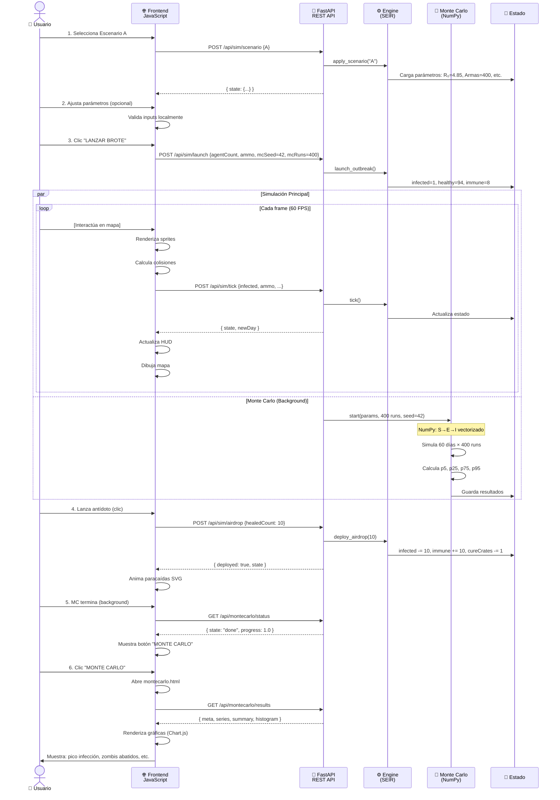

# 🏗️ Arquitectura de MantaZero: Epidemic Command

---

## ☁️ Arquitectura Cloud en AWS (Despliegue de Producción)

El sistema opera bajo un despliegue contenerizado administrado mediante **AWS ECS Fargate** en la región **`us-east-1` (N. Virginia)**.

### Diagrama de Infraestructura AWS



### Componentes AWS y Superficie de Exposición:
1. **Zonas Públicas:**
   - **Puerto 8080 (HTTP):** Expuesto públicamente mediante Elastic Network Interface (ENI) con IP pública para acceso directo de usuarios y jurados al mapa interactivo y endpoints REST.
2. **Zonas Privadas y Protegidas:**
   - **VPC Subnet:** Red aislada donde reside la tarea de cómputo.
   - **IAM Least Privilege:** Rol `ecsTaskExecutionRole` restringido exclusivamente a lectura en ECR y escritura de logs hacia CloudWatch.
   - **Sin Base de Datos Expuesta:** El estado epidemiológico se ejecuta efímeramente en memoria de Python con latencia menor a 2 ms.

---

## 🧩 Diagrama General de Software (Capas de Aplicación)



---

## Flujo de Datos: Ciclo de Simulación



---

## Arquitectura por Capas

```
┌─────────────────────────────────────────────────────────────┐
│                     PRESENTACIÓN (Frontend)                 │
│  HTML5 + CSS3 + Vanilla JavaScript + Leaflet + Chart.js    │
│  - index.html: Interfaz táctica en tiempo real              │
│  - montecarlo.html: Dashboard de resultados                 │
│  - assets/sprites: GIFs Metal Slug (zombis, soldados)       │
└─────────────────────────────────────────────────────────────┘
                           ↕ REST JSON
┌─────────────────────────────────────────────────────────────┐
│                    API REST (FastAPI)                       │
│  - Health check, presets, simulación CRUD                   │
│  - Endpoints: /api/sim/*, /api/montecarlo/*                │
│  - CORS habilitado (demo) → restrictivo en prod             │
└─────────────────────────────────────────────────────────────┘
                           ↕ Métodos Python
┌─────────────────────────────────────────────────────────────┐
│               LÓGICA DE NEGOCIO (Backend)                   │
│                                                             │
│  1️⃣ SeirSimulationEngine (backend/engine.py)               │
│     - Estado principal: día, hora, S/E/I/R                 │
│     - Métodos: launch, tick, register_zombie_hit,          │
│       deploy_airdrop                                        │
│     - Transiciones: E→I (binomial), I→Muerto (combate)    │
│                                                             │
│  2️⃣ MonteCarloRunner (backend/montecarlo.py)               │
│     - Thread background: NumPy vectorizado                  │
│     - Entrada: params, runs, seed                          │
│     - Salida: series {S,E,I,R} + estadísticas             │
│     - 500-5000 simulaciones de 60 días c/u                 │
└─────────────────────────────────────────────────────────────┘
                           ↕ Python/NumPy
┌─────────────────────────────────────────────────────────────┐
│        NÚCLEO EPIDEMIOLÓGICO (Modelos Matemáticos)         │
│                                                             │
│  SEIR Estocástico:                                         │
│  - S → E: Binomial(S, 1 - exp(-β·I/N))                    │
│  - E → I: Binomial(E, 1 - exp(-1/τ_incub))                │
│  - I → R: Binomial(I, 0.25) si hay cajas                  │
│  - I → D: min(Binomial(I, p_kill), munición/8)            │
│                                                             │
│  Parámetros:                                               │
│  - β: Tasa de contagio (R₀ / días_infecciosos)           │
│  - p_kill: 1 - exp(-1.2 · soldados/agentes)              │
│  - R₀: 1.15 - 4.85 según escenario                        │
│  - τ_incub: 5-15 segundos (escala epidemiológica)        │
└─────────────────────────────────────────────────────────────┘
                           ↕ NumPy Arrays
┌─────────────────────────────────────────────────────────────┐
│                   ALMACENAMIENTO (Estado)                   │
│                                                             │
│  - Estado en memoria: Dict Python {day, infected, ...}    │
│  - Sin persistencia: Reset en cada nueva simulación        │
│  - Parámetros: Presets.py + inputs REST                   │
│  - Resultados MC: Numpy arrays → JSON en memoria           │
│                                                             │
│  Futuro (AWS):                                             │
│  - S3: Guardar simulaciones completas (.json)             │
│  - DynamoDB: Histórico de corridas                        │
│  - CloudWatch: Logs + métricas                            │
└─────────────────────────────────────────────────────────────┘
```

---

## Componentes Clave

### 1. **Frontend (HTML5 + Vanilla JS)**

**Archivos:**
```
frontend/
├── index.html                    # UI principal
├── montecarlo.html              # Dashboard resultados
├── css/arcade.css               # Estilos tema oscuro/arcada
├── js/
│   ├── engine.js                # State machine simulación
│   ├── manta-config.js          # Configuración rutas Manta
│   ├── sprites.js               # Manejo sprites GIF
│   ├── tailwind-config.js       # Configuración Tailwind
│   └── audio.js                 # Efectos de sonido SFX
└── assets/
    └── manta_routes.js          # GeoJSON rutas OpenStreetMap
```

**Responsabilidades:**
- Renderizar interfaz táctica
- Dibujar agentes en mapa con Leaflet.js
- Hacer polling a API REST
- Animar sprites zombis/soldados
- Mostrar gráficas Chart.js

---

### 2. **Backend FastAPI (Python)**

**main.py** - Servidor HTTP
```python
# Endpoints:
GET  /api/health          # Healthcheck
GET  /api/presets         # Obtener escenarios A/B/C
GET  /api/state           # Estado actual

POST /api/sim/reset       # Reinicia simulación
POST /api/sim/scenario    # Carga parámetros escenario
POST /api/sim/launch      # Inicia brote + MC
POST /api/sim/tick        # Avanza 1 frame
POST /api/sim/combat-hit  # Registra disparo
POST /api/sim/airdrop     # Lanza antídoto

GET  /api/montecarlo/status   # % completado
GET  /api/montecarlo/results  # Resultados JSON
```

---

### 3. **Motor SEIR (engine.py)**

```python
class SeirSimulationEngine:
    state = {
        "day", "hour", "minute",
        "healthy", "bitten", "infected", "immune",
        "ammo", "cureCrates", "deaths", "r0", ...
    }
    
    def reset()              # Reinicia estado
    def launch_outbreak()    # Inicia con params
    def tick()               # Avanza 1 frame (~10 min virtual)
    def register_zombie_hit() # -1 ammo, -1 HP zombi
    def deploy_airdrop()     # Cura infecciones
```

**Transiciones por tick:**
1. Incubación: `E → I` (si período cumplido)
2. Contagio: `S → E` (nuevo contacto)
3. Combate: `I → Muerto` (si hay munición)
4. Antídoto: `I → R` (si hay caja + lanzada)
5. Síntesis: Genera 1 nueva caja cada 10 días

---

### 4. **Monte Carlo (montecarlo.py)**

```python
class MonteCarloRunner:
    def start(params, runs=400, seed=42)
        # Inicia thread background
        
    def _simulate(rng, params, n)
        # Vectorizado en NumPy:
        # S, E, I, R = arrays[n, days+1]
        # Para cada día:
        #   - Contagio Poisson
        #   - Incubación Binomial
        #   - Combate Binomial
        #   - Antídotos Binomial
        
    def _aggregate(chunks, params, runs, seed)
        # Combina resultados:
        # - Series temporales (mean, p5, p25, p75, p95)
        # - Estadísticas: peakInfected, finalInfected, etc.
        # - Histograma: distribución picos
```

**Rendimiento:**
- 400 runs × 60 días: ~2 segundos (NumPy vectorizado)
- Threading: No bloquea API principal
- Reproducibilidad: Semilla `np.random.default_rng(42)`

---

## Flujo de Datos: Específico

### Línea Base: "No Intervenir"
```
t=0: S=270,900 | E=0 | I=1 | R=245 | Muertes=0

t=1: S≈270,750 | E≈150 | I≈50 | R=245
     (Contagio exponencial sin freno)
     
t=30: S≈100,000 | E≈5000 | I≈150,000 | R=245
      (Pico de infecciones, crecimiento incontrolable)
      
t=60: S≈50,000 | E≈1000 | I≈5000 | R=245
      (Mayoría se infectó, infección decae por falta de S)
      
Resultado: 220,000 infectados acumulados
```

### Línea Base: "Estrategia Óptima"
```
t=0: S=270,900 | E=0 | I=1 | R=245 | Munición=800 | Cajas=3

t=5: Lanzar 1 caja
     S≈270,800 | E≈100 | I≈30 | R≈300 (curados por antídoto)

t=10: Combate + 2ª caja
      I≈50 (abatidos por munición) | I→10 (por antídoto)
      Munición=400 | Cajas=2
      
t=30: Síntesis genera caja 4
      R≈10,000 (muchos curados)
      I≈500 (contenido por intervención)
      
t=60: I≈100 | R≈50,000 | Munición≈50 (crítico)
      
Resultado: 50,000 infectados acumulados (77% menos que no intervenir)
```

---

## Escalabilidad Arquitectónica

### Local (Ahora)
- ✅ Backend: FastAPI en puerto 8080
- ✅ Frontend: Archivos estáticos HTML/JS
- ✅ Data: En memoria (Dict Python)
- Límite: ~100 usuarios concurrentes

### AWS Elastic Beanstalk (Corto Plazo)
- Instancia t3.small: auto-scaling
- ALB: distribución de carga
- Data: Estado en memoria (sin persistencia)
- Límite: ~500 usuarios concurrentes

### AWS Serverless (Mediano Plazo)
- Lambda: API sin servidor
- S3 + CloudFront: Frontend + CDN
- DynamoDB: Persistencia resultados
- Step Functions: Orquestación MC paralelo
- Límite: ~10,000 usuarios concurrentes

### Multi-Región AWS (Largo Plazo)
- Lambda + API Gateway en us-east-1, eu-west-1, ap-southeast-1
- S3 replicación multi-región
- DynamoDB global tables
- Route 53: Geo-routing
- Límite: Ilimitado (con costos >$5K/mes)

---

## Seguridad

### Actual (Demo)
- ❌ Sin autenticación
- ❌ CORS abierto (`["*"]`)
- ✅ Sin credenciales en código
- ✅ Sin inyección SQL (no hay BD)

### Producción (Checklist)
- [ ] API Key o JWT en headers
- [ ] CORS restringido a dominio cliente
- [ ] Rate limiting: 100 req/min por IP
- [ ] HTTPS obligatorio
- [ ] Logs de auditoría en CloudWatch
- [ ] WAF en CloudFront (AWS)
- [ ] Validación inputs + sanitización
- [ ] Secrets en AWS Secrets Manager

---

## Monitoreo & Observabilidad

### Métricas Clave
```
CloudWatch Dashboards:
- Lambda duration (p50, p95, p99)
- S3 request rate
- API response time
- MC completion time
- Errores y excepciones

Alarmas:
- Lambda errors > 1%
- API latency > 5s
- MC timeout > 60s
- S3 403/404 rate > 5/min
```

### Logs
```
CloudWatch Logs:
- /aws/lambda/mantazero-api
- /aws/s3/mantazero-frontend
- Application logs (FastAPI)
- Errores de simulación SEIR
```

---

**Diagrama preparado:** 27 de octubre de 2026  
**Versión:** 1.0  
**Arquitecto:** Equipo bottitos-spookython
