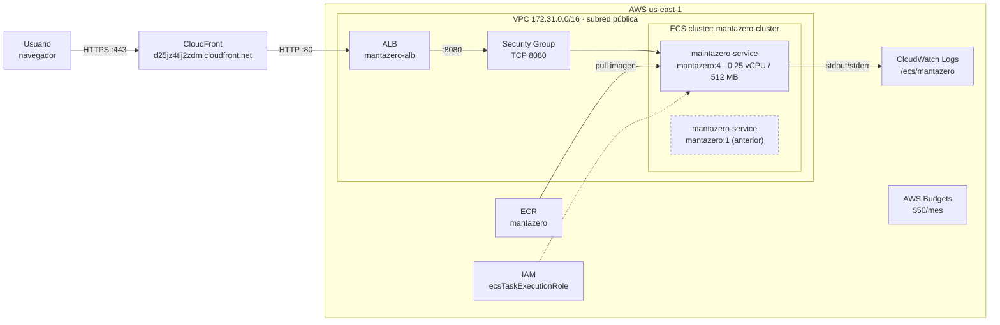
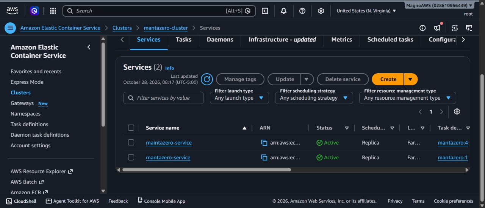
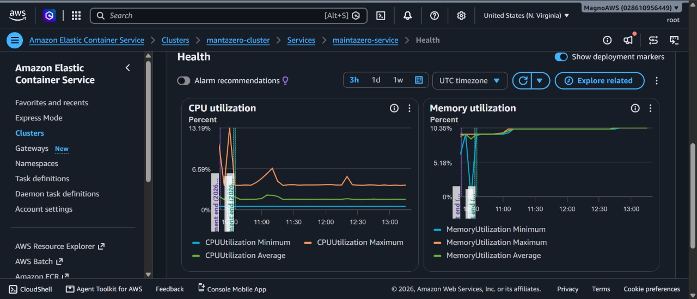
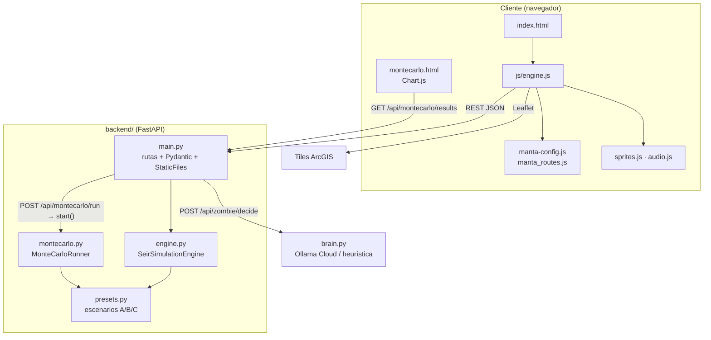
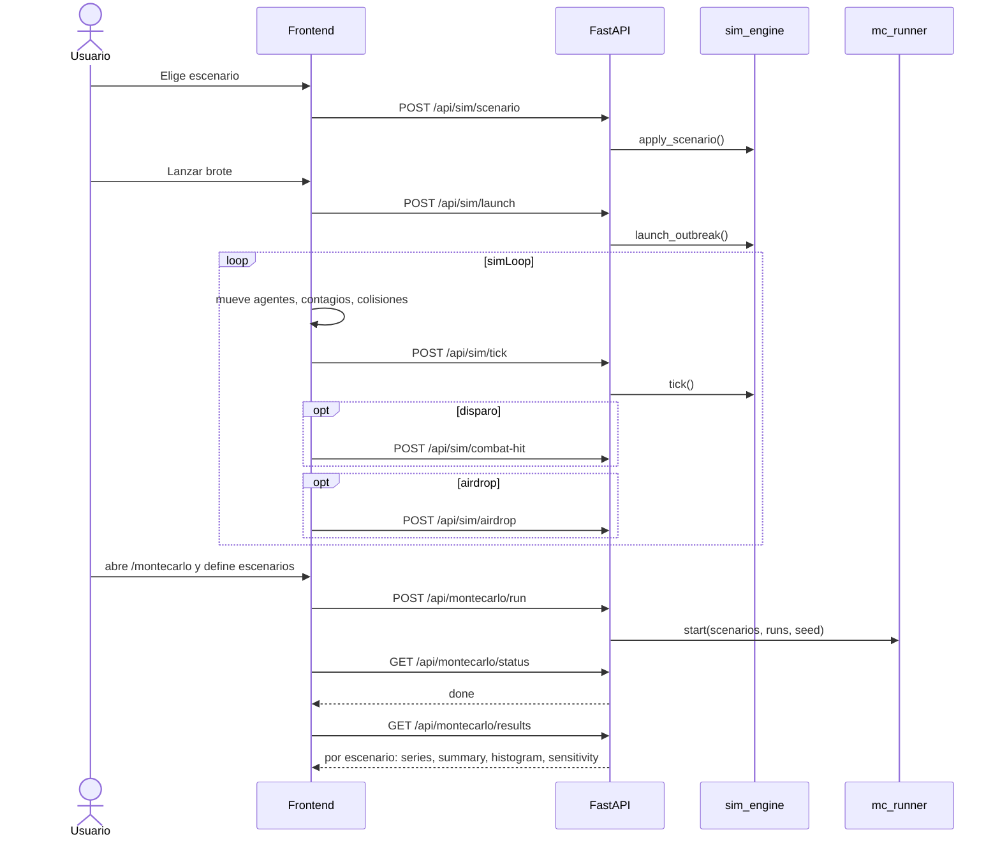

# Arquitectura · MantaZero: Epidemic Command

El diagrama completo y editable está en [arquitectura.excalidraw](arquitectura.excalidraw); se abre en excalidraw.com. Este documento detalla cada parte.

---

## 1. Infraestructura AWS

Contenedor único en ECS Fargate, región `us-east-1`.

| Componente | Configuración |
| :--- | :--- |
| CloudFront | Distribución `E1FNOA31MWJ4YA`, `d25jz4tlj2zdm.cloudfront.net`. Certificado de Amazon, `redirect-to-https`, origen `http-only` al ALB. Cache policy `CachingDisabled` y origin request `AllViewerExceptHostHeader`: la API no se cachea. Todos los métodos HTTP. (`infra/cloudfront-distribution.json`) |
| ALB | Listener HTTP :80 (origen de CloudFront), target en el contenedor :8080. |
| Security Group | Inbound TCP 8080 desde `0.0.0.0/0` (`infra/deploy-ecs.ps1`). |
| Tarea | `mantazero:4`, 0.25 vCPU / 512 MB, `assignPublicIp=ENABLED`, HEALTHCHECK `GET /api/health` (start period 30 s). |
| IAM | `ecsTaskExecutionRole`: lectura de ECR y escritura de logs. |
| Datos | Ninguna base de datos; todo el estado vive en memoria del proceso. |

### Ruta de una petición

1. El navegador abre `https://d25jz4tlj2zdm.cloudfront.net/...`. CloudFront termina TLS con su certificado por defecto (`*.cloudfront.net`); si la petición llega por HTTP, responde 301 a HTTPS.
2. Con `CachingDisabled`, cada petición va al origen. `AllViewerExceptHostHeader` reenvía query string, headers y cookies, salvo `Host`, para que el ALB reciba su propio hostname.
3. CloudFront se conecta al ALB por HTTP :80 (`http-only`, read timeout 30 s, 3 intentos).
4. El ALB enruta al target del servicio `maintazero-service` en el puerto :8080 del contenedor.
5. FastAPI responde: estáticos desde `frontend/` o JSON desde `/api/*`.

Como no hay caché, el polling de `/api/montecarlo/status` y los `tick` siempre devuelven el estado vivo.

### Estado en producción

- `maintazero-service` → `mantazero:4`: servicio actual, detrás del ALB.
- `mantazero-service` → `mantazero:1`: despliegue anterior, todavía Active.
- Uso medido (CloudWatch, 3 h): CPU promedio ~2 % con pico de 13.19 % en el despliegue, memoria ~10 % (~51 MB). La tarea está sobredimensionada para la carga actual.

### Build y despliegue

1. `Dockerfile`: imagen `python:3.14-slim` que copia `backend/` y `frontend/` y arranca con `python -m backend.main`.
2. `infra/buildspec.yml`: CodeBuild hace login en ECR, `docker build` y `push`.
3. `infra/deploy-ecs.ps1` + `infra/ecs-task-definition.json`: crean el log group, registran la task definition y crean el cluster y el servicio.

4. `infra/deploy-cloudfront.ps1` + `infra/cloudfront-distribution.json`: crean la distribución CloudFront con el ALB como origen.

El ALB no está en los scripts; se creó desde la consola.

---

## 2. Componentes de software

### Frontend (`frontend/`)

| Archivo | Responsabilidad |
| :--- | :--- |
| `index.html` | Mapa, HUD y controles. Carga Leaflet (unpkg) y Tailwind (CDN). |
| `js/engine.js` | Estado local, `syncBackend()`, agentes sobre la red vial, colisiones y combate, `simLoop()`, HUD, curva SEIR en vivo, escenarios, airdrop, cerebro del paciente cero (`/api/zombie/decide`). |
| `js/manta-config.js` | 20 nodos (intersecciones reales de Manta) y centro del mapa. |
| `assets/manta_routes.js` | Geometría de rutas entre nodos, generada con `scripts/`. |
| `js/sprites.js` | `HERO_ROSTER`, `MANTA_SPRITES` (GIFs). |
| `js/audio.js` | `SFX`. |
| `montecarlo.html` | Laboratorio multi-escenario: configurador (fijo o rango por parámetro), comparativa KPI, banda P5–P95 de zombis, rango del pico, probabilidades y sensibilidad (Spearman). |

La simulación por agente (movimiento, mordidas, incubación, disparos) corre en el navegador. El servidor es la fuente de verdad de los contadores, la munición, las cajas, el reloj y el puntaje.

### Pipeline de datos (`scripts/`, offline)

- **Red vial:** `node scripts/generate_all_routes.js` consulta OSRM entre los 20 nodos y escribe `frontend/assets/manta_routes.js`.
- **Sprites SEIR:** `generar_sprites.py` (PIL) (`python scripts/generar_sprites.py`) dibuja de forma procedural `sano`, `mordido`, `zombie` y `exorcizado` (`.gif` + `_sheet.png`) y `estados_preview.gif`.

---

## 3. API (`backend/main.py`)

| Método | Ruta | Acción |
| :--- | :--- | :--- |
| GET | `/api/health` | Estado del servicio y `zombieMaxHp`. |
| GET | `/api/presets` | Escenarios A/B/C. |
| GET | `/api/state` | Estado actual de la simulación. |
| POST | `/api/sim/reset` | Reinicia el estado. |
| POST | `/api/sim/scenario` | `{scenario}`: aplica el preset (incluye R₀). |
| POST | `/api/sim/launch` | `LaunchRequest`: paciente cero. No arranca el Monte Carlo (ADR-003). |
| POST | `/api/sim/tick` | `{infected, bitten, immune, ammo}`: avanza el reloj 10 min. |
| POST | `/api/sim/combat-hit` | `{zombieId}`: −1 bala, −1 HP; baja al 8.º impacto. |
| POST | `/api/sim/airdrop` | `{healedCount}`: −1 caja, curados → sanos (no inmuniza). |
| POST | `/api/montecarlo/run` | `{runs, seed, scenarios:[{name, params}]}`; params fijos o `{min, max}`. Devuelve `runId`. |
| POST | `/api/zombie/decide` | Próxima ruta del paciente cero: LLM en Ollama Cloud o heurística (ADR-004). |
| GET | `/api/montecarlo/status` | `idle` / `running` / `done` / `error` y progreso. |
| GET | `/api/montecarlo/results` | Resultados; responde 202 mientras corre. |
| GET | `/montecarlo` | Sirve `montecarlo.html`. |
| GET | `/*` | Frontend estático (`StaticFiles`, `html=True`). |

CORS abierto (`allow_origins=["*"]`).

---

## 4. Motor en vivo (`backend/engine.py`)

`sim_engine` es un singleton por proceso y todos los clientes comparten la misma simulación.

- **Estado:** reloj (día, hora, minuto), contadores S/E/I/R y muertes, munición, cajas, progreso de síntesis, puntaje y parámetros del escenario. `zombie_hp` guarda el HP de cada zombie.
- **`tick()`:** recibe los contadores del cliente, avanza 10 min y sintetiza antídoto. El progreso sube `0.12` por tick con prioridad `med` (si no, `0.07`), multiplicado por `(1 + 5 · inmunes / población) · speed`. Al llegar a 100 suma una caja.
- **`register_zombie_hit()`:** sin munición responde `NO_AMMO`. Cada baja suma 250 puntos.
- **`deploy_airdrop()`:** sin cajas responde `NO_CRATES`. Suma 500 puntos por curado.

---

## 5. Monte Carlo (`backend/montecarlo.py`)

Hilo daemon con `Lock` para status y resultados; `start()` está serializado y cancela la corrida previa, y cada corrida lleva un `runId`. Por escenario, las réplicas se ejecutan en 10 lotes sobre un único `default_rng(seed)`. Cada parámetro en rango se muestrea uniforme por réplica.

Por día y por réplica, vectorizado en NumPy, con N = 271 145:

| Transición | Fórmula |
| :--- | :--- |
| S → E | `Binomial(S, 1 − exp(−β·I/N))`, β = R₀ · mult / 5 |
| E → I | `Binomial(E, 1 − exp(−1/τ))`, τ = max(0.5, incubaciónSeg · 0.5) días |
| I → abatido | `min(Binomial(I, p_kill), I, ⌊munición / 10⌋)`, p_kill = 1 − exp(−1.2 · armados / agentes) |
| Laboratorio | +1 caja cada 10 días |
| Antídoto | cada 5 días, si hay caja: `Binomial(I, 0.25)` y `Binomial(E, 0.25)` → S; armados += ⌈0.15 · curados⌉ |

`mult` = 1.3 en carnaval × 1.1 de noche × 0.7 con cerco vial.

**Salida (por escenario):** series S/E/I/R (media, P5, P25, P75, P95), estadísticas del pico, día del pico, infectados finales, total contagiado, abatidos y munición restante; probabilidad de contención y de agotamiento de munición; histograma de picos; sensibilidad Spearman (rangos promedio) de cada parámetro en rango frente al pico y al total de afectados.

**Rendimiento:** 400 runs × 60 días ≈ 2 s.

---

## 6. Ciclo de una partida

---

## 7. Seguridad

**Estado actual:** HTTPS en CloudFront. Sin autenticación y con CORS `*`. El ALB sigue aceptando HTTP directo en :80 y el Security Group deja el 8080 abierto a Internet, así que se puede saltar CloudFront. No hay credenciales en el código ni base de datos.

**Pendiente para producción:**

- [x] HTTPS con CloudFront.
- [ ] ALB que solo acepte tráfico de CloudFront (prefix list `com.amazonaws.global.cloudfront.origin-facing` o header secreto).
- [ ] Security Group de la tarea que solo acepte tráfico del SG del ALB.
- [ ] CORS restringido al dominio.
- [ ] Rate limiting y WAF.
- [ ] Autenticación (API key o JWT) en los endpoints de escritura.
- [ ] Una simulación por sesión, en lugar del singleton global.

---

## 8. Escalabilidad

| Etapa | Cambio | Límite principal |
| :--- | :--- | :--- |
| Actual | 1 tarea Fargate, estado en memoria | Una simulación compartida; no escala horizontalmente. |
| Corto plazo | Estado por sesión (Redis/DynamoDB), N tareas detrás del ALB | Costo por tarea. |
| Mediano plazo | Frontend en S3 + CloudFront; Monte Carlo en un worker o cola (SQS) | Latencia del Monte Carlo. |
